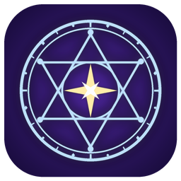

<p align="center"></p>
<h2 align="center">Kronos Reborn</h2>
<p align="center">Swap the DLSS, FSR and XeSS version any game runs, in a couple of clicks, and undo it just as easily.</p>
<p align="center"><a href="https://github.com/SpaceJamp/Kronos-Reborn/releases/latest"><b>Download</b></a> · Windows 10 and 11, 64-bit</p>

---

Games ship with whatever version of NVIDIA DLSS, AMD FSR or Intel XeSS was current when they were
made, as DLL files in the game's folder. Newer versions often look sharper, ghost less or run faster,
but a game rarely updates them. Kronos Reborn finds your games, shows what each one runs, and puts in
the version you choose. Every file it replaces is backed up first, so nothing is ever lost.

## Getting started

1. **Download** the [latest release](https://github.com/SpaceJamp/Kronos-Reborn/releases/latest).
   Take the installer (`KronosReborn-<version>-installer.exe`), or the portable zip if you'd rather
   not install anything.
2. **Run it.** The builds aren't code-signed yet, so Windows SmartScreen may say the publisher is
   unknown. Choose **More info**, then **Run anyway**.
3. **Press Refresh.** Your games appear as covers, each listing the version of every runtime it has.

Nothing else needs installing: .NET comes built in.

## Swapping a version

1. **Pick a game**, then pick a version for each runtime in the pane on the right. Or press
   **⬆ Newest** to choose the newest signed version you hold for every game at once.
2. **Check the preview.** It lists every file that will change, and warns about downgrades and
   mismatched DLSS parts.
3. **Press Apply.**

Changed your mind? **Undo last apply** in the status bar puts back everything that Apply changed.
**Undo** and **Redo** step one game back and forth, and **Restore original** returns a game to the
files it shipped with.

Don't have a newer version yet? Open **Download** and press **Get newest for my games**. Files come
straight from NVIDIA, AMD and Intel's own GitHub repositories.

## Handy extras

- **Needs update** shows only the games you hold a newer version for.
- **Right-click a cover** to open its folder, undo, restore or hide it. Hidden games come back from
  **Settings**.
- **Drop a `.dll`** on the window to add it to your collection.
- **Keys:** F5 refresh · Ctrl+F search · Ctrl+Z / Ctrl+Y undo and redo · Ctrl+Enter apply.
- **It remembers** your search, filter and the page you were on.
- **It keeps itself up to date.** When a new release is out, the status bar offers it. An installed
  copy updates in one click; a portable one opens the release page. Turn the check off in Settings.

## Where it finds games

Steam, GOG, Epic, Ubisoft Connect, Battle.net, the EA app and the Xbox app are found automatically.
For anything else, such as repacks or DRM-free games:

- **+ Add Folder** adds a folder where every subfolder is a game, such as `C:\Games`. New games in it
  show up on the next refresh.
- **+ Add Game** adds one game by its folder.

Removing either from **Settings** never touches the game's files.

## Runtimes it handles

| Runtime | Files |
| --- | --- |
| DLSS, Frame Generation, Ray Reconstruction | `nvngx_dlss.dll`, `nvngx_dlssg.dll`, `nvngx_dlssd.dll` |
| FSR 3.1 (DirectX 12, Vulkan) | `amd_fidelityfx_dx12.dll`, `amd_fidelityfx_vk.dll` |
| FSR upscaler and frame generation (FidelityFX SDK 2) | `amd_fidelityfx_upscaler_dx12.dll`, `amd_fidelityfx_framegeneration_dx12.dll` |
| XeSS, XeSS Frame Generation, XeSS DX11, XeLL | `libxess.dll`, `libxess_fg.dll`, `libxess_dx11.dll`, `libxell.dll` |

DLLs are found up to ten folders deep, which covers Unreal Engine games. If a game has several copies
of a DLL, all of them are swapped.

## Questions

**Is it safe for my games?**
Every file is backed up before it's replaced, and undo checks the game still holds what Kronos Reborn
put there before restoring. If a game update changed the file since, undo leaves it alone rather than
overwrite it.

> [!WARNING]
> **Online games with anti-cheat.** Some anti-cheat systems flag changed game files. Swapping a DLL in
> an online multiplayer game can get you kicked or banned. Use it on single-player games, or check the
> game's rules first.

**Can I trust the files?**
Downloaded and imported DLLs count as trusted only if they're validly signed by NVIDIA, AMD or Intel.
Anything else needs your OK, and is flagged again before it goes into a game. **⬆ Newest** only ever
picks signed versions.

**What does it send over the internet?**
- A game's name to Steam's store, once, to find a cover when Steam doesn't have one cached.
- A request to GitHub to check for app updates, and to the vendors' repositories when you download.

Nothing about you is sent.

**Something went wrong. How do I report it?**
Open **Diagnostics**. It checks your collection, backups and undo history, and shows recent errors
and crashes. **Export…** saves a zip of the logs and data that you can attach to an
[issue](https://github.com/SpaceJamp/Kronos-Reborn/issues).

**Linux?**
Planned. Windows comes first.

## Your data

Everything lives in `%LOCALAPPDATA%\KronosReborn` as plain files you can read:

| | |
| --- | --- |
| `settings.json` | Your settings |
| `catalog.json` | The versions you hold |
| `runtimes\` | Imported and downloaded DLLs |
| `backups\`, `history\` | Copies of replaced files, and the undo history for each game |
| `manual-games.json`, `game-folders.json` | Games and folders you added |
| `posters\` | Covers fetched from Steam's store. Delete it to look them up again |
| `logs\` | The log |

A file that can't be read is set aside as `*.unreadable-*`, never overwritten, so it can still be
recovered.

## Building from source

Needs the .NET 10 SDK.

```powershell
dotnet build .\KronosReborn.sln -c Release
dotnet run --project .\tests\KronosReborn.Tests -c Release   # not dotnet test, which finds no tests
```

To package it, run `package\build.cmd` for the portable zip, then `package\package.cmd` for the
installer (needs Inno Setup: `winget install JRSoftware.InnoSetup`). Both land in `package\Output\`.

CI restores from the committed `packages.lock.json` files in locked mode. It also checks formatting,
builds with warnings as errors, runs the tests and packages both. After changing a package reference,
run `dotnet restore .\KronosReborn.sln --force-evaluate` and commit the lock files. Pushing a `v*`
tag publishes a release.

```
src/KronosReborn/          the window (Avalonia)
src/KronosReborn.Core/     everything else: discovery, swapping, undo, downloads, updates
tests/KronosReborn.Tests/  tests
package/                   build and installer scripts
docs/spec.md               the specification; requirements are cited by number in the code
```

## Licence

[Personal and Non-Commercial Use License (PNC-1.2)](LICENSE). In short, you may use, study and change
Kronos Reborn for personal, non-commercial use. You may share it, or your changed version, free of
charge. A changed version you share must come with its full source, under the same licence.
Commercial use of any kind needs the author's written permission.

DLSS, FSR, FidelityFX and XeSS are trademarks of their owners. This project is not affiliated with
NVIDIA, AMD or Intel.
